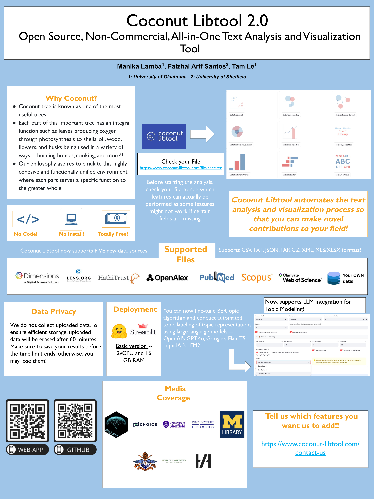

## Publications

Here is a (mostly complete, but probably not fully up to date) list of all my peer-reviewed publications. A more comprehensive and up-to-date listing is available at my Google Scholar profile.

<h4>Recent Posters</h4>





